# Open Sourcing Engine

Finds US-based pre-seed and seed AI companies before they announce a round. It collects early signals, merges them per company, scores only what the web can show, and ranks the result for each investor, learning from their votes.

Built at SearchHack (2026-11-14) on Telem and Tavily. Live demo: https://llamaengine.insforge.site

## What it does

1. **Collect.** Telem Monitors and pinned Telem searches watch for launch posts, founding-engineer job posts, "left to start a company" posts, papers and cohort listings. Tavily maps cohort and lab pages and diffs them. SEC Form D, GitHub and Show HN are read directly.
2. **Merge.** Signals about the same company are joined on website, LinkedIn URL, GitHub handle and name. A shared name alone never merges two companies with different websites.
3. **Corroborate.** A company seen in one place gets one routed Telem search for a second, independent signal.
4. **Gate.** A company reaches the digest only if it has two independent signal families, one of its own sources states a US location, and a per-company funding search shows no Series A, no more than $10M raised and no valuation above $50M.
5. **Score.** Each company is scored on the eight-dimension rubric in `rubric.json`. A dimension with no public evidence is marked U and left unscored. Every claim carries a label: F for the founder's own claim, V for a verified record, A for the agent's inference.
6. **Rank.** Order is the low end of the score range, P + (100 − C) / 5, plus a bonus for one standout dimension (level 4 or 5, halved when only the founder's claims support it, ambition excluded), plus the investor's own preferences.
7. **Learn.** A thumbs vote with a reason is stored as an append-only event and shifts that investor's preferences. The reason decides what moves. A reason can also be typed in the investor's own words; it is read by keyword in the browser (founder, market, product, traction, technology, signal), with no model call, and a note that mentions none of them moves everything a little.
8. **Watch.** Real startups seen in only one place stay on a per-sector watchlist, unscored, until a second signal arrives.

In the page, each person sets up their own investor through a short dialog (sectors, signals, traits, rubric weights), can hide company names to judge a list on evidence alone, and can compare how two investors' top lists drift apart as they vote.

## System design

```mermaid
flowchart LR
  subgraph Sources
    M[Telem Monitors<br/>seq cursor]:::telem
    P[Telem pinned search<br/>LinkedIn posts, X, Product Hunt]:::telem
    T[Tavily Map diff<br/>cohort and lab pages]
    D[SEC Form D, GitHub, Show HN]
  end
  Sources --> X[Extract<br/>small model]
  X --> R[Resolve entities]
  R --> C[Corroborate<br/>Telem routed search]:::telem
  C --> G[Gates<br/>2 signals, not raised, US-based]
  G --> S[Score<br/>large model, U where unobservable]
  S --> K[Rank per investor]
  K --> U[Digest page]
  U -- vote + reason --> F[(Investor memory<br/>append-only events)]
  F --> K
  classDef telem fill:#ecf6f0,stroke:#1d8f58;
```



| Stage | File |
|---|---|
| Monitors | `src/monitors.ts` |
| Telem ingest and discovery searches | `src/sources/telemIngest.ts` |
| Tavily Map diff | `src/sources/tavily.ts` |
| Form D, GitHub, Show HN | `src/sources/edgar.ts`, `github.ts`, `hn.ts` |
| Extract | `src/extract.ts` |
| Resolve | `src/resolve.ts` |
| Corroborate | `src/corroborate.ts` |
| Gates | `src/gates.ts`, `src/locate.ts` |
| Score | `src/score.ts` |
| Rank, learn, compare | `src/rank.ts` |
| Chinese copies of score detail (display only) | `src/translate.ts` |
| Backtest | `src/backtest.ts` |
| With vs without Telem | `src/ablation.ts` |
| Costs and model budget | `src/costs.ts`, `src/claude.ts` |
| Page | `src/web/app.ts`, `public/index.html` |

## Results from the hackathon run

These numbers are from 2026-11-14. `sample/data.json` is the data behind the live demo.

### Funnel

| Step | Count |
|---|---|
| Signals ingested | 1,951 |
| Companies after entity resolution | 452 |
| Pass the two-signal gate | 160 |
| Removed: already announced a round, or outside the funding range | 53 |
| Removed: not confirmed US-based | 45 |
| Removed: already known to the operator | 6 |
| **In the digest** | **56** |

Another 268 single-signal startups sit on the watchlist.

### With Telem vs without Telem

Same stored signals, same entity resolution and gate. The right column drops every signal that came through Telem.

| | With Telem | Without Telem |
|---|---|---|
| Signals | 1,951 | 518 |
| Companies | 452 | 95 |
| Pass the two-signal gate | 160 | 1 |
| Digest companies that still pass | 56 | 0 |

352 companies were surfaced only by Telem. Corroboration is itself a Telem search, so part of the gate gap comes from the design.

### Blind backtest

The engine's own queries were run as of 2026-08-16 with no company names, on signals dated 2026-06-17 to 2026-08-16. The answer key is a sample of 300 AI pre-seed and seed rounds announced after the cutoff.

| | Surfaced | Later announced a round | Median lead | Precision (lower bound) | Recall vs sample |
|---|---|---|---|---|---|
| Shortlist, after the gate | 27 | 0 | n/a | 0% | 0% |
| All resolved companies | 161 | 2 | 85 days | 1.2% | 0.3% |

This shows the method, not a lead-time claim. 73% of Telem results carried no publish date and were dropped, GitHub star history as of a past date is no longer readable, and a hit requires a matching website.

### Cost

| Run | Cost | Unit cost |
|---|---|---|
| Ingest: 1,392 raw items, 264 new signals | $0.51 | $0.002 per signal |
| Build: corroborate, gate, locate, funding check, score | $3.13 | $0.06 per digest company |
| **One full search cycle** | **$3.64** | **$0.07 per digest company** |
| Monitor tick | $0.02 to $4.90 | three of the eight monitors cost $2.50 to $4.90 on every tick |

Bulk extraction runs on a small model and only scoring uses a large one: the same extraction load cost $6.35 on the large model and $0.018 on the small one. Model calls are refused past `CLAUDE_BUDGET_USD` in total or `CLAUDE_RUN_BUDGET_USD` per run.

## Run it

The page works straight from a clone, using the sample data:

```bash
npm install
```

```bash
npm run serve
```

Then open http://localhost:4173.

To collect your own data, copy `.env.example` to `.env`, add keys, and run:

```bash
npx tsx src/monitors.ts up
```

```bash
npx tsx src/seeds.ts
```

```bash
npx tsx src/pipeline.ts all
```

```bash
npx tsx src/backtest.ts
```

```bash
npx tsx src/costs.ts
```

```bash
npx tsx src/translate.ts
```

Notes:
- `src/translate.ts` writes Simplified Chinese copies of the score detail to `data/zh.json`, keyed by a hash of the English, so a re-run translates only new or changed text. The page shows them in 中文 mode and falls back to English. Scoring and ranking never read them. The copies in `sample/data.json` were machine-translated and checked only for preserved numbers.
- Funding lookups and the backtest answer key use the Monid CLI (`@monid-ai/cli`), which needs its own account.
- Shared investor memory is optional. `api/` is a small Node service that stores votes and profiles in Postgres (set `DATABASE_URL` and `ALLOWED_ORIGINS`; it creates its own tables, and only reads or writes one memory space at a time). `npm run build:site` builds the static page into `public/` and points it at that service when `MEMORY_API_URL` is set. Without it, profiles and votes stay in the browser. `db/memory.sql` is the earlier InsForge setup.
- `seeds.local.json` (gitignored) can hold your own list of people to watch: `{"people":[{"name":"..."}]}`.

## Rules the code enforces

- Scoring reads only raw source text and fresh company-site extracts. The engine's own summaries are display-only.
- A claim whose URL is not one of the company's sources is dropped. A dimension with only inferences is U.
- Investor demand and growth path are always U before contact.
- Location comes from a stated headquarters, office or filing address. Nothing is inferred from a person's name or background.
- The standout bonus changes order only, never a score.
- Every run is recorded with its cost. Re-runs add nothing already stored.

## Known gaps

- **The funding filter is new and only partly proven.** Until the last run of 2026-11-14 the "already raised" check relied on a funding-data lookup by website, which was over its daily budget and missed companies even when it ran. A manual web check then found five digest companies well past seed: River AI ($1.1B), Ricursive Intelligence ($300M Series A), Deep Cogito ($43M Series A), Helicon ($16.5M seed) and Plurai ($13M seed). The last run replaced the lookup with one routed Telem search per company, cached, and a stated range: Series A or later, more than $10M raised, or a reported valuation over $50M puts a company out. It removed those five and one more. Its figures come from search-result summaries, so a wrong match is possible, and 11 of 59 companies checked had no public funding record at all.
- The backtest has two hits; it demonstrates the method only.
- Investor preferences are a simple weighted list. Votes do not yet carry over to similar companies.
- Founder profile changes are not tracked.
- Monitor spend has no cap of its own.
